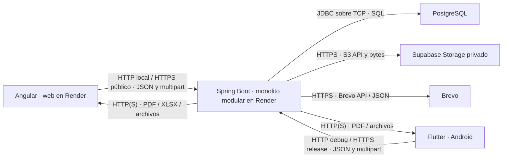

# Vidia

**Plataforma web y Android para gestionar eventos universitarios de la UAJMS.**

*Donde los eventos cobran vida.*

[Aplicación web](https://trabajo-final-diplomado-web.onrender.com/) · [Catálogo](https://trabajo-final-diplomado-web.onrender.com/eventos) · [Swagger API](https://trabajo-final-diplomado.onrender.com/swagger-ui/index.html) · [Descargar APK](https://github.com/felix-lamas/trabajo-final-diplomado/releases/download/v1.0.0/app-release.apk)


> Captura del 12/10/2026 reutilizada del manual de usuario. Los eventos y cantidades corresponden a esa demostración; no son indicadores actuales de adopción institucional.

## El proyecto

Vidia centraliza información y seguimiento de eventos de la **Universidad Autónoma Juan Misael Saracho (UAJMS)**: publicación, inscripción, comprobantes de pagos externos, sesiones, asistencia y certificados. Busca reducir la dispersión de registros y facilitar el trabajo de organizadores, administradores y participantes.

La web ofrece funciones de los tres perfiles; Android está destinado a participantes. Ambos clientes utilizan el mismo backend. Las categorías son administrables: la demostración incluye conferencias, talleres, cursos, seminarios, jornadas y actividades culturales y deportivas, presenciales o virtuales.

Es un proyecto académico de ingeniería de software. Código, capturas y respuesta de salud son evidencias diferentes: no demuestran por sí solos validación institucional, disponibilidad continua ni cumplimiento de todos los requisitos.

### Objetivos y alcance

El objetivo general de la monografía es desarrollar una plataforma web y móvil que centralice información y facilite inscripciones, pagos, asistencia y certificación. Sus seis objetivos específicos abarcan análisis de procesos/requisitos; diseño de arquitectura, datos, interfaces y contratos; implementación; seguridad; validación mediante pruebas; y despliegue/documentación. La redacción oficial está en el apartado 1.5 de la [monografía](docs/documentoFinal/Monografia_Vidia_Final.docx).

Quedan fuera la pasarela de pagos integrada, facturación electrónica, chat interno, streaming propio, reconocimiento facial, blockchain, múltiples universidades y gestión móvil para administradores u organizadores.

## Funcionalidades y roles

| Proceso | Función implementada | Perfil |
|---|---|---|
| Acceso y perfil | Registro, verificación de correo, login, recuperación/restablecimiento, perfil y logout | Participante; acceso según cuenta para gestores |
| Solicitud de organizador | Solicitar y consultar resolución; aprobar o rechazar | Participante / administrador |
| Eventos | Crear borradores propios, editar y enviar a revisión; revisar y publicar mediante transiciones autorizadas | Organizador / administrador |
| Catálogo | Buscar, filtrar y consultar eventos publicados | Público y usuarios |
| Inscripciones | Inscribirse, consultar estado y cancelar cuando las reglas lo permitan; controlar duplicados y cupos | Participante; gestores consultan en su ámbito |
| Pagos | Consultar instrucciones externas, presentar JPG/JPEG/PNG/PDF y revisar comprobantes | Participante; organizador propietario / administrador |
| Sesiones y asistencia | Gestionar sesiones, emitir QR temporal compartido, escanear en Android y validar inscripción, horario y GPS cuando aplique | Gestores / participante |
| Certificados | Emitir para inscripciones elegibles, consultar/descargar PDF y verificar públicamente por código | Gestores / participante / público |
| Historial | Consultar inscripciones, pagos, asistencias y certificados propios | Participante |
| Categorías y reportes | Administrar categorías; consultar indicadores y exportar reportes de eventos, participantes, pagos y certificados en PDF/XLSX | Administrador; reportes también para organizador en su ámbito |

**Reglas importantes:**

- `USUARIO` corresponde al participante y habilita inscripción/asistencia propias.
- `ORGANIZADOR` gestiona sus eventos y los envía a revisión. La publicación `EN_REVISION → PUBLICADO` corresponde a `ADMINISTRADOR`. El organizador aprobado conserva `USUARIO`.
- `ADMINISTRADOR` resuelve solicitudes y eventos, administra categorías y accede a operaciones institucionales. Ese rol por sí solo no concede endpoints exclusivos de `USUARIO` u `ORGANIZADOR`.
- Un comprobante presentado **no equivale a pago aprobado**. Vidia no mueve dinero ni integra una pasarela.
- El QR pertenece a la sesión, no al participante. Dura como máximo dos minutos y puede revocarse al emitir otro; varios participantes pueden utilizarlo, con una asistencia por inscripción/sesión. JWT y token QR son distintos.
- El servidor comprueba GPS cuando corresponde: precisión máxima de 30 m y distancia más precisión dentro del radio configurado. No garantiza presencia física ni impide toda falsificación de ubicación.

Los [RF-01 a RF-13](docs/07_Requerimientos_Funcionales.md) conservan sus identificadores. Los cortes E3.4 y las matrices históricas no describen necesariamente el estado productivo actual.

## Interfaces

Imágenes reales del **12/10/2026**, con datos de demostración, revisadas para esta publicación. No se generaron pantallas simuladas.

<details>
<summary><strong>Web: acceso, gestión y seguimiento</strong></summary>


</details>

<details>
<summary><strong>Android y certificados</strong></summary>


</details>

Estas capturas muestran pantallas o consultas existentes, no la ejecución de cada acción disponible. El recorrido físico QR/GPS completo sigue pendiente en el manual. [Procedencia y recortes](docs/images/readme/README.md).

## Arquitectura

El backend es un **monolito modular organizado en capas**: controladores REST, servicios, repositorios y entidades. Sus nueve módulos son `usuarios`, `categorias`, `eventos`, `inscripciones`, `pagos`, `sesiones`, `asistencias`, `certificados` y `reportes`.



La URL de producción Angular usa HTTPS y Android release lo exige. La conexión JDBC y TLS productivos requieren comprobar la configuración del servicio; no se deducen de Render.

Supabase utiliza su interfaz **S3 compatible**, con credenciales solo en backend, para comprobantes y archivos QR de pago. No se asume que todo documento/fotografía se almacene allí. Los certificados PDF se generan al descargarlos. Supabase no sustituye PostgreSQL ni autentica usuarios de Vidia.

El correo predeterminado es `brevo-api`, mediante HTTPS/JSON. Existe la alternativa SMTP, seleccionada todavía en `.env.example`; adapte el ejemplo al ambiente. El almacenamiento local es otra alternativa de desarrollo. Las selecciones y credenciales efectivas del panel de Render no se inspeccionaron.

## Tecnologías

| Componente | Tecnología | Versión confirmada | Responsabilidad |
|---|---|---|---|
| Backend | Java / Spring Boot | Java 21 / Boot 3.3.0 en POM | API, negocio y transacciones |
| Web | Angular | `^21.0.0` declarado; 21.2.17 resuelto en lock | Interfaces de los tres perfiles |
| Android | Flutter / Dart | Local comprobado: 3.44.8 / 3.12.2; pubspec exige Dart `>=3.12.0 <4.0.0` | Participante; app 1.0.0+1 |
| Persistencia | PostgreSQL / JPA / Hibernate | Compose: `16-alpine`; Hibernate 6.5.2.Final en JAR comprobado el 12/10; PostgreSQL productivo no verificado | Modelo relacional y repositorios |
| Seguridad | Spring Security / JJWT | Security 6.3.0 en ese JAR; JJWT 0.12.5 declarado | Roles, JWT, sesiones y BCrypt |
| Migraciones | Flyway | 10.10.0 en ese JAR; V1–V5 versionadas | Evolución del esquema |
| API | Springdoc OpenAPI | 2.5.0 declarado | Swagger/OpenAPI |
| QR | ZXing / qrcode / mobile_scanner | 3.5.3 POM / `^1.5.4` package / `^7.4.2` pubspec | QR de certificados, imagen web y escaneo móvil |
| Archivos/PDF | Apache Tika / iText | 2.9.2 / 8.0.4 declarados y utilizados | Detección de contenido y PDF |
| Integraciones | Supabase S3 / Brevo API | AWS SDK 2.55.10 declarado; servicios sin versión fijada | Archivos privados y correo |
| Construcción | Maven / Node / npm / Docker | Imagen Maven 3.9.9 + Temurin 21; npm 11.6.3 declarado | Compilación y contenedor backend |
| Alojamiento/distribución | Render / GitHub Releases | Sin versión de servicio fijada; Android v1.0.0 publicada | Web/backend y APK |

Manifiestos, versiones resueltas, herramientas locales y producción son categorías distintas. No se afirma que Render ejecute las versiones locales. [Compatibilidad y preparación](docs/manuales/instalacion-local.md).

## Inicio rápido

### Versión publicada

Abra la [web](https://trabajo-final-diplomado-web.onrender.com/) o el [catálogo](https://trabajo-final-diplomado-web.onrender.com/eventos). Para Android, consulte la [release v1.0.0](https://github.com/felix-lamas/trabajo-final-diplomado/releases/tag/v1.0.0); el proyecto declara mínimo API 24. Siga el [manual de uso](docs/manuales/uso-del-sistema.md). No se publican contraseñas de demostración.

### Entorno local

```powershell
git clone https://github.com/felix-lamas/trabajo-final-diplomado.git
cd trabajo-final-diplomado
Copy-Item .env.example .env
```

**Antes de iniciar:** prepare PostgreSQL exclusivamente local, configure `DB_USER`, `DB_PASS`, un `JWT_SECRET` Base64 propio y `APP_STORAGE_PROVIDER=local`; adapte correo y perfil siguiendo el [manual local](docs/manuales/instalacion-local.md). Copiar el ejemplo sin adaptarlo no basta.

En terminales independientes, comenzando desde la raíz:

```powershell
cd backend
mvn spring-boot:run
```

```powershell
cd frontend
npm ci
npm start
```

```powershell
cd flutter/VidiaApp
flutter pub get
flutter run --dart-define=API_BASE_URL=http://10.0.2.2:8080/api/v1
```

El último comando presupone Android Emulator disponible. Web: `http://localhost:4200`. API: `http://localhost:8080/api/v1`. Swagger: `http://localhost:8080/swagger-ui/index.html`. En teléfono físico configure una dirección de desarrollo accesible: `localhost` identifica el teléfono, no el PC. No use producción como base de pruebas locales.

## Documentación

| Guía | Contenido |
|---|---|
| [Instalación local](docs/manuales/instalacion-local.md) | Herramientas, PostgreSQL, variables, arranque, Android y pruebas |
| [Despliegue y operación](docs/manuales/despliegue-produccion.md) | Render, Docker, servicios externos, firma y recuperación |
| [Uso del sistema](docs/manuales/uso-del-sistema.md) | Recorridos por perfil y diferencias web/Android |

Material conservado:

- [Anexo A Word](docs/documentoFinal/Anexo_A_Manual_de_Usuario_Vidia.docx) y [Anexo B Word](docs/documentoFinal/Anexo_B_Manual_de_Instalacion_Despliegue_Mantenimiento_Vidia.docx): evidencias detalladas y comprobaciones pendientes.
- [Monografía editable](docs/documentoFinal/Monografia_Vidia_Final.docx).
- [Requisitos no funcionales](docs/08_Requerimientos_No_Funcionales.md) y [trazabilidad histórica](docs/12_Matriz_de_Trazabilidad.md).
- [Secuencias Enterprise Architect](scripts/enterprise-architect/README.md).
- [Informe de revisión](docs/auditoria/README_REVISION_20261013.md): discrepancias y límites de esta actualización.

Los documentos `docs/release_1_0/` y los cortes E3.4 se conservan como antecedentes; las tres guías describen la configuración actual inspeccionada.

## Pruebas y verificación

| Evidencia conservada del 12/10/2026 | Resultado registrado |
|---|---|
| Backend, `mvn -B clean verify` | 591 pruebas: 590 aprobadas, 1 omitida; sin fallos/errores |
| Angular, `npm test -- --watch=false` | 316 aprobadas; build con advertencias de tamaño |
| Flutter, `flutter test --reporter expanded` | 139 aprobadas |
| Flutter, `flutter analyze` | Salida 1; 17 observaciones informativas |

Fuentes: [JUnit](docs/documentoFinal/evidencias_anexo_b_20261012/backend_junit_resumen.json), [Angular](docs/documentoFinal/evidencias_anexo_b_20261012/angular_test.txt), [Flutter](docs/documentoFinal/evidencias_anexo_b_20261012/flutter_test.txt) e [informe Anexo B](docs/documentoFinal/evidencias_anexo_b_20261012/Informe_Ejecucion_Anexo_B.md). **No se ejecutaron nuevamente estas suites en la actualización del 13/10/2026.** Las pruebas opt-in y sus condiciones están en la guía local.

Las consultas de lectura del 13/10 devolvieron 200 para web, Swagger, OpenAPI, salud, release y enlace APK por HEAD; perfil anónimo y raíz backend devolvieron 401. Salud respondió `{"estado":"UP"}`: acredita respuesta puntual, no una consulta SQL ni disponibilidad continua.

Pendientes: recorrido físico QR/GPS, validación completa de correo/archivos externos, configuración privada de Render, versión PostgreSQL productiva y recuperación operativa. El manual conserva incidencias de consulta de sesiones Android y enlaces de certificados dirigidos a localhost observadas el 12/10; no se dan por resueltas sin otra ejecución.

## Seguridad y colaboración

El backend implementa BCrypt, JWT con sesión persistida, autorización por rol/propiedad, validación de DTO/archivos y límites de intentos en memoria por instancia. Angular usa almacenamiento del navegador; Flutter, almacenamiento seguro. Estas medidas no constituyen seguridad absoluta ni un limitador distribuido.

No versione `.env`, claves API, secretos JWT, keystores ni contraseñas de firma. La CSP del build Angular no acredita las cabeceras efectivas del hosting. Consulte [operación](docs/manuales/despliegue-produccion.md).

Tika comprueba contenido/tipo de archivo; no es un antivirus. Revise también archivos de cargas locales antes de añadir cambios a Git.

Antes de proponer cambios, revise requisitos, ejecute pruebas pertinentes y explique su alcance. No se encontró licencia general ni CONTRIBUTING del proyecto: **no se atribuye una licencia de código abierto**. Revise también las licencias de dependencias antes de redistribuir.

[GitHub](https://github.com/felix-lamas/trabajo-final-diplomado) · [GitLab](https://gitlab.com/lamasfelix/trabajo-final-diplomado)

Ambos remotos están configurados. El 13/10 sus referencias `main` coincidían en `f6891ef`, pero el árbol local tiene cambios sin publicar: no demuestra sincronización de todas las ramas ni de esta documentación. No se realizó commit ni push.
