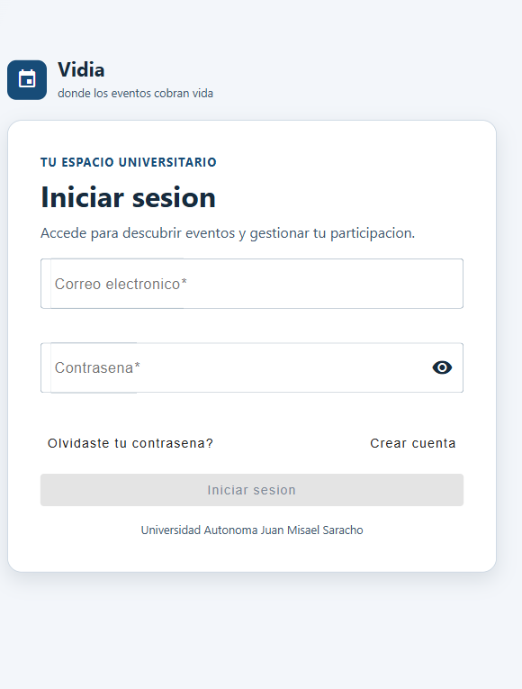
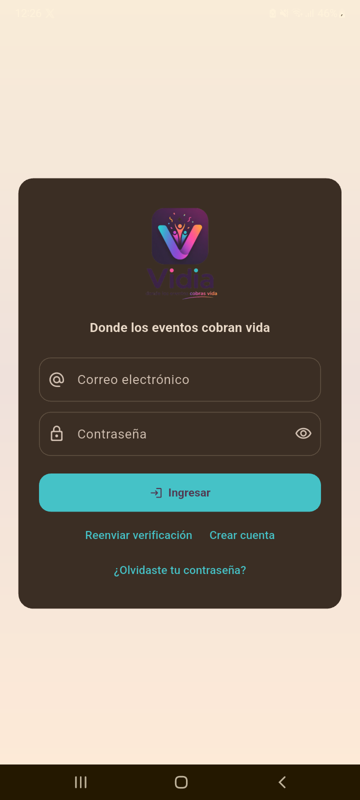
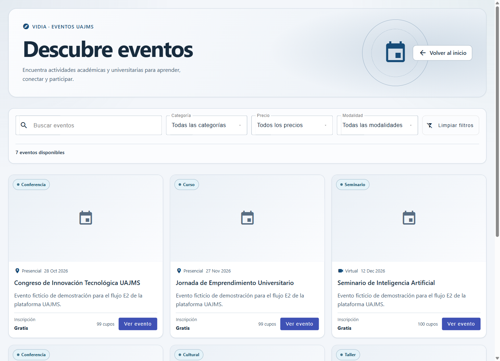
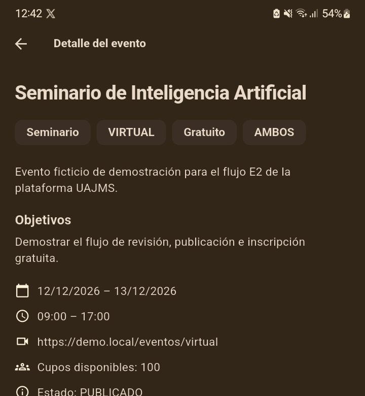
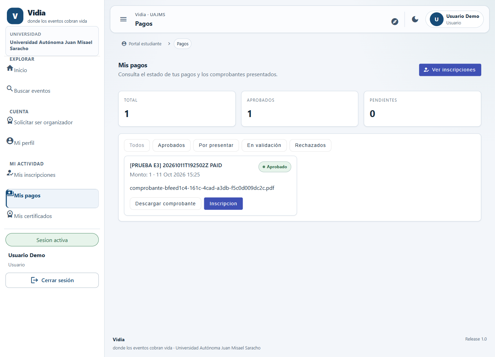
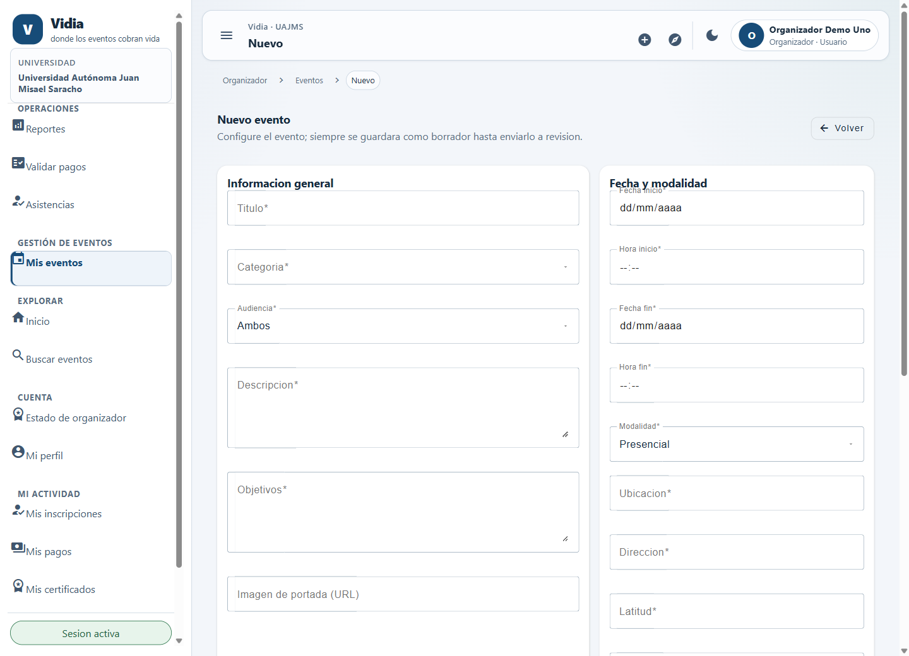
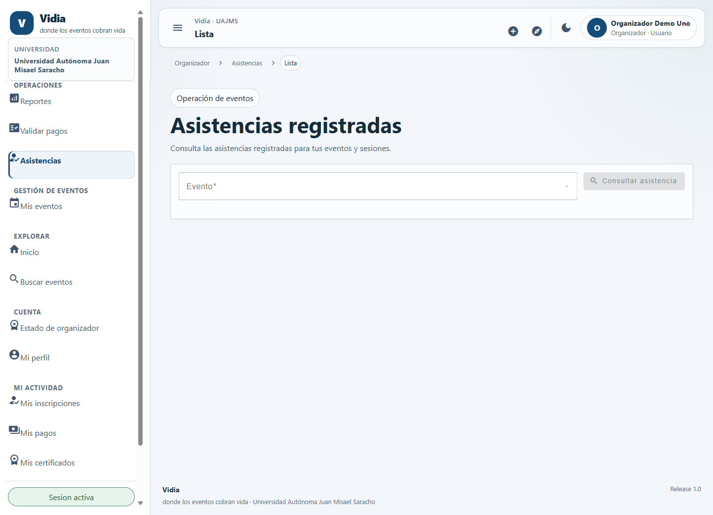
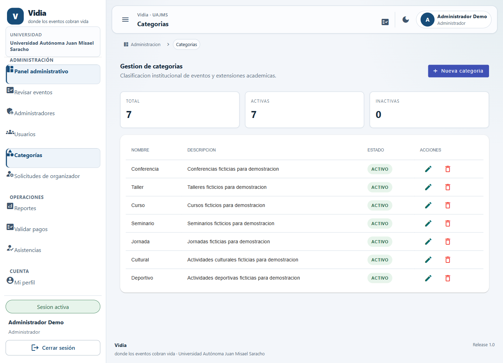
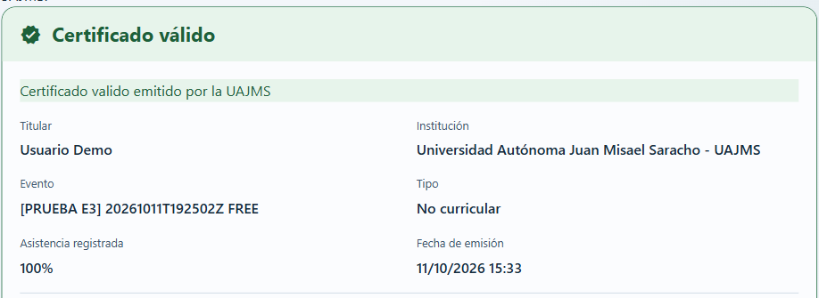

# Manual de uso del sistema

[README](../../README.md) · [Instalación](instalacion-local.md) · [Operación](despliegue-produccion.md)

Vidia organiza eventos universitarios de la UAJMS. La web incluye funciones para participantes y gestores; Android está destinado al participante. La disponibilidad de acciones depende de su rol, del estado del evento y de los registros existentes.

Los pasos se contrastaron con interfaces/código actuales y el Anexo A. Las capturas proceden del 12/10/2026; esta revisión no envió formularios de negocio ni volvió a autenticar cuentas productivas. Los resultados descritos son los previstos por la aplicación; los recorridos no comprobados completamente se indican al final.

## 1. Acceder y crear cuenta

1. Abra la [web](https://trabajo-final-diplomado-web.onrender.com/) o Vidia en Android. En web aparece **Iniciar sesión**; en Android, **Ingresar**.
2. Si no tiene cuenta, utilice **Crear cuenta**, complete los campos solicitados y envíe el formulario.
3. Verifique su correo siguiendo el enlace recibido. En Android existe **Reenviar verificación** si necesita solicitarlo otra vez.
4. Introduzca correo y contraseña en la pantalla de acceso. El menú refleja los permisos de su cuenta.
5. Para recuperar acceso, utilice **Olvidaste tu contraseña?** en web o **¿Olvidaste tu contraseña?** en Android y siga el enlace recibido.

La recepción de correo depende del servicio configurado; no se comprobó nuevamente su entrega. No comparta enlaces de activación/recuperación ni contraseñas. Si falla cerrar sesión por comunicación, atienda el mensaje: no dé por confirmada la revocación en el servidor.

La aplicación mantiene una sesión activa por cuenta: iniciar sesión en otro cliente puede revocar la anterior. Si cambia entre web y Android y recibe un aviso de sesión revocada, vuelva a autenticarse en el cliente que utilizará.

La APK está en la [release oficial](https://github.com/felix-lamas/trabajo-final-diplomado/releases/tag/v1.0.0). Descárguela desde esa fuente y siga las indicaciones Android para instalarla. No requiere activar opciones de desarrollador. La instalación del APK publicado no se repitió en esta revisión.

## 2. Participante

### Consultar eventos

1. En web, abra **Buscar eventos** o el [catálogo público](https://trabajo-final-diplomado-web.onrender.com/eventos). En Android abra **Eventos**.
2. Busque por texto y aplique los filtros disponibles. En web puede filtrar categoría, precio y modalidad y utilizar **Limpiar filtros**.
3. Pulse **Ver evento** en web o abra el evento en Android para consultar fechas, modalidad, inscripción y requisitos.

El catálogo muestra eventos publicados, no borradores pendientes de revisión.

### Inscribirse y consultar estado

Requisitos: sesión activa de participante, evento publicado que admita inscripción y cupo cuando corresponda.

1. Abra el detalle y la opción de inscripción; en Android aparece **Inscribirme**.
2. Revise la información y confirme la solicitud cuando esté disponible.
3. Consulte **Mis inscripciones** en web o **Actividad** en Android.

Un evento gratuito crea inscripción confirmada; uno de pago queda pendiente de pago. Un duplicado, falta de cupos o estado no permitido se rechaza. El formulario previo fotografiado en el Anexo A no demuestra por sí solo una inscripción nueva enviada.

Si utiliza cancelar, revise sus condiciones y confirmación antes de aceptar. No es una operación para ensayar sobre registros reales. El servidor solo admite cancelación en los estados permitidos.

### Pagos y comprobantes

1. Abra **Mis pagos** en web o gestione el pago desde su inscripción en Android.
2. Consulte monto e instrucciones del organizador. Realice el pago por el medio externo indicado, fuera de Vidia.
3. Cuando su estado habilite presentar comprobante, seleccione un documento real propio, legible, JPG/JPEG/PNG/PDF, máximo 5 MB.
4. En Android revise la confirmación **Enviar comprobante** antes de pulsar **Enviar**. En web siga la acción **Presentar comprobante** cuando esté habilitada.
5. Consulte el estado posterior. Presentar el archivo inicia revisión; no aprueba automáticamente el pago.

No cargue documentos ajenos ni comprobantes ficticios como pagos reales. La siguiente imagen solo muestra un pago de demostración existente, sin contenido del documento.

### Registrar asistencia en Android

Requisitos: inscripción confirmada, sesión habilitada dentro de su horario y QR temporal mostrado por el responsable.

1. Desde **Actividad**, acceda a la función de asistencia y seleccione evento/sesión.
2. Pulse **Escanear código de asistencia** y permita el uso de cámara cuando la aplicación lo solicite.
3. Escanee el QR temporal de la **sesión**. No utilice un comprobante QR de pago ni un código de certificado.
4. Si se solicita **Ubicación para validar asistencia**, confirme su uso y permita ubicación según las opciones del dispositivo.
5. Espere el resultado. Si hay error de permiso, QR expirado, sesión no disponible, ubicación insuficiente o asistencia duplicada, revise el mensaje y consulte al responsable cuando corresponda.

La asistencia presencial valida ubicación y precisión; no se garantiza presencia física únicamente por GPS. El QR puede compartirse entre inscritos durante su vigencia; no es personal. En sesiones virtuales sin coordenadas puede no solicitarse GPS.

El recorrido físico completo no se comprobó en el manual: el 12/10 hubo una incidencia al consultar sesiones desde Android. No se presenta una captura de éxito simulado.

### Historial y certificados

1. En Android consulte **Actividad** y **Historial** para su información personal; en web utilice **Mis inscripciones**, **Mis pagos** y **Mis certificados**.
2. En certificados, abra el documento disponible y la acción de descarga.
3. Si aún no aparece, consulte al organizador: la emisión exige evento finalizado, inscripción confirmada, pago aprobado cuando corresponda y reglas de asistencia/certificación satisfechas.

El participante no emite sus propios certificados. No se garantizan certificados para todo inscrito ni se confunde asistencia enviada con asistencia validada.

El certificado curricular requiere horas académicas positivas y al menos 80% de asistencia a sesiones requeridas. El no curricular exige asistencia real en al menos una sesión requerida; no se aplica el mismo porcentaje mínimo adicional.

## 3. Organizador: web

### Solicitar condición de organizador

1. Con cuenta participante, abra **Solicitar ser organizador** en web o la solicitud desde **Perfil** en Android.
2. Revise y envíe su solicitud cuando corresponda.
3. Consulte su estado: el administrador decide aprobación o rechazo. **Estado de organizador** permite seguir la resolución en web.

Una solicitud pendiente no habilita gestión. La cuenta aprobada conserva funciones de participante; la gestión se realiza desde la web, no desde Android.

### Crear y gestionar eventos propios

1. Abra **Mis eventos** y la opción de nuevo evento.
2. Complete información general, categoría, audiencia, fechas, modalidad y los campos de inscripción, pago, ubicación y certificación que correspondan.
3. Utilice **Guardar borrador**. Revise el detalle y complete lo necesario antes de enviar.
4. Use la opción de envío a revisión. El evento pasa de BORRADOR a EN_REVISION cuando cumple las reglas.
5. Consulte el resultado administrativo. Un evento rechazado debe seguir el proceso disponible para corregirse; no se publica directamente como organizador.

### Inscripciones, pagos, sesiones y certificados

1. Abra su evento y consulte participantes/inscripciones dentro de su ámbito.
2. En **Validar pagos**, revise el comprobante y resuelva únicamente cuando tenga autorización y evidencia suficiente; registre el motivo requerido al rechazar.
3. Acceda a las sesiones del evento y complete las fechas, horas y configuración de asistencia que correspondan.
4. Genere el QR de asistencia desde una sesión que admita emisión; muestre el QR vigente a los participantes. Emitir otro revoca el anterior.
5. En **Asistencias**, seleccione evento y utilice **Consultar asistencia**.
6. Gestione la emisión de certificados cuando finalice el evento y se cumplan sus condiciones. Consulte **Reportes** para indicadores/exportaciones de sus eventos.

La figura muestra la consulta de asistencias antes de seleccionar evento, no un registro presencial exitoso.

## 4. Administrador: web

1. Abra **Panel administrativo** para la información disponible.
2. En **Solicitudes de organizador**, revise los antecedentes y resuelva mediante las acciones permitidas.
3. En **Revisar eventos**, examine el evento enviado y apruebe/publice o rechace con el motivo requerido. La publicación está sujeta al estado de revisión.
4. En **Categorías**, gestione la clasificación y sus estados. Revise dependencias antes de eliminar una categoría.
5. En **Usuarios** y **Administradores**, consulte las operaciones disponibles, incluidos permisos/invitaciones según la pantalla y las reglas. No se presupone un editor universal de todos los roles/permisos.
6. Utilice **Reportes**, **Validar pagos** y **Asistencias** dentro de su autorización. Los reportes disponibles se exportan en PDF/XLSX.

No cambie cuentas, roles o estados de registros reales para practicar. Una invitación administrativa requiere una cuenta y un correo autorizados; nunca comparta su enlace de activación.

## 5. Verificación pública

1. Abra la URL pública `/verificar-certificado` de la web.
2. Introduzca el código que aparece en el certificado y pulse **Verificar código**.
3. Lea la respuesta: un código inexistente o inválido no debe darse por válido. Puede utilizar **Nueva consulta** para otra comprobación.

No se exige iniciar sesión. Si un enlace descargado dirige a localhost, utilice la dirección pública y comunique la incidencia al responsable; no altere el certificado. El 12/10 se documentó este problema de enlace y una consulta manual válida de un certificado ficticio.

## 6. Recomendaciones y límites

- Mantenga credenciales privadas y atienda avisos de sesión expirada/revocada.
- No publique QR temporales, ubicación personal, comprobantes ni enlaces de recuperación.
- Distinga inscripción pendiente, pago aprobado, asistencia validada y certificado emitido.
- Revise fechas y condiciones antes de confirmar acciones que cambien registros.
- Si falla correo, consulta de sesiones o conexión, comunique el contexto sin entregar secretos.

Pendientes del recorrido documentado: entrega real de verificación/recuperación, nueva inscripción desde UI, presentación/revisión de comprobantes en todas las condiciones, QR/GPS físico, resoluciones administrativas e invitación/activación completas. La existencia de interfaces no equivale a ejecución satisfactoria de cada operación. El [Anexo A Word](../documentoFinal/Anexo_A_Manual_de_Usuario_Vidia.docx) conserva evidencias y marcadores específicos, sin modificarse por esta tarea.
